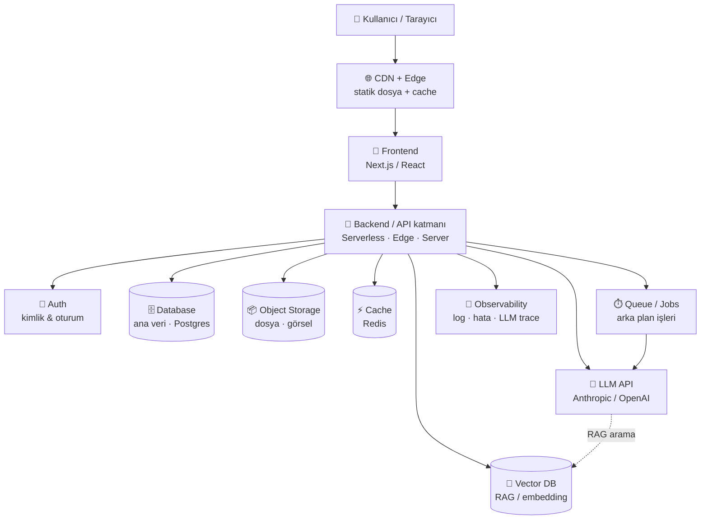
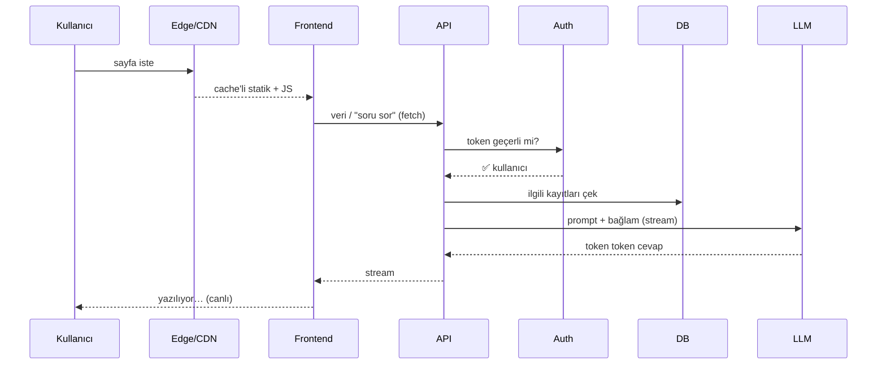
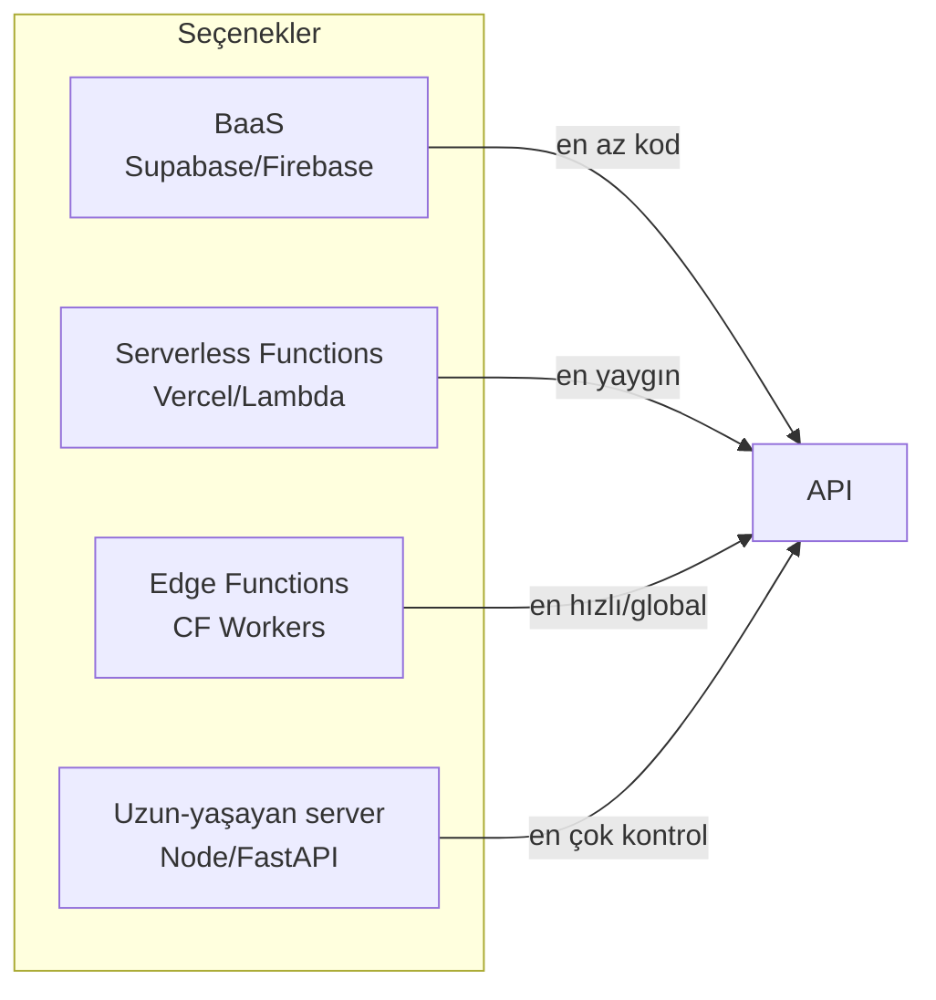
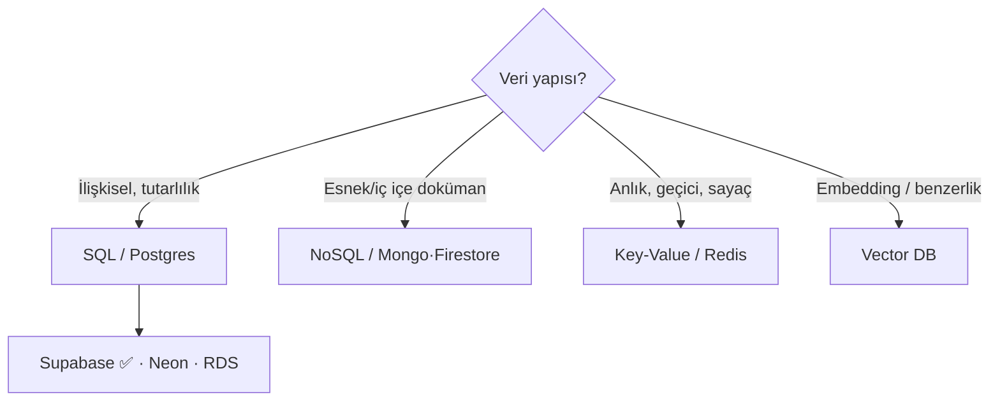
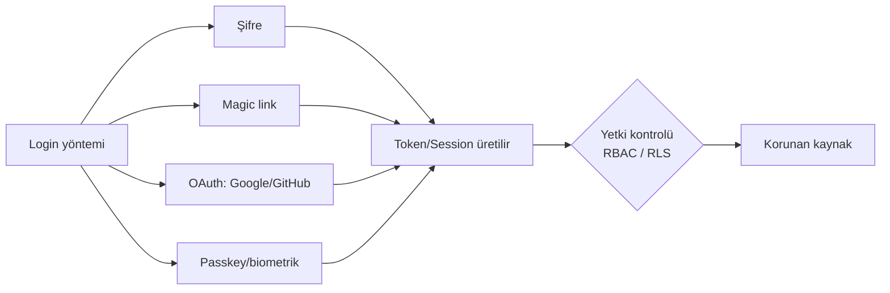
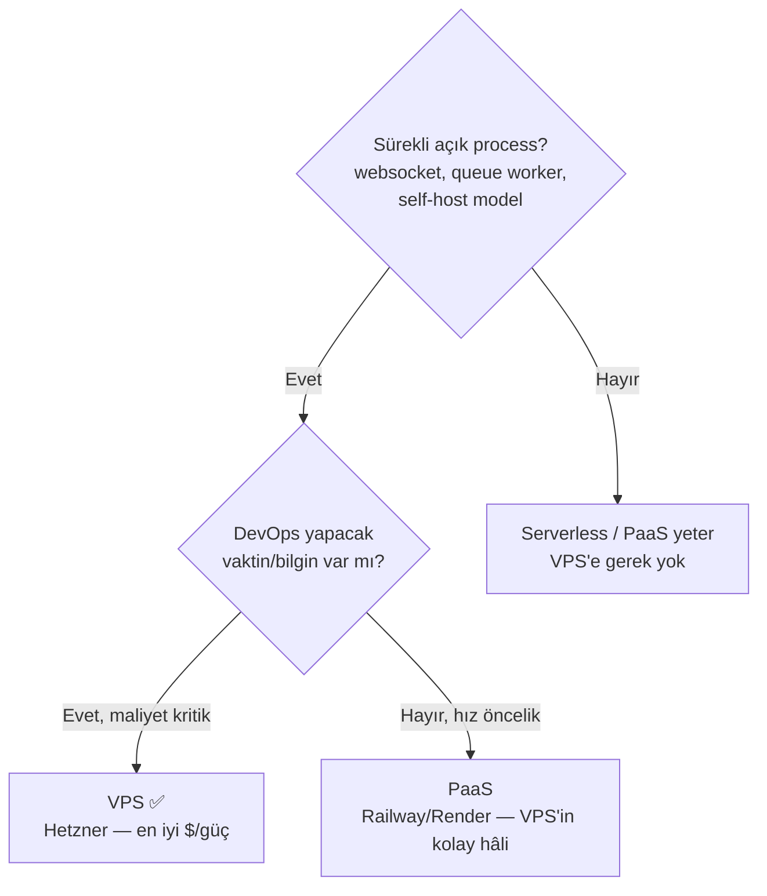
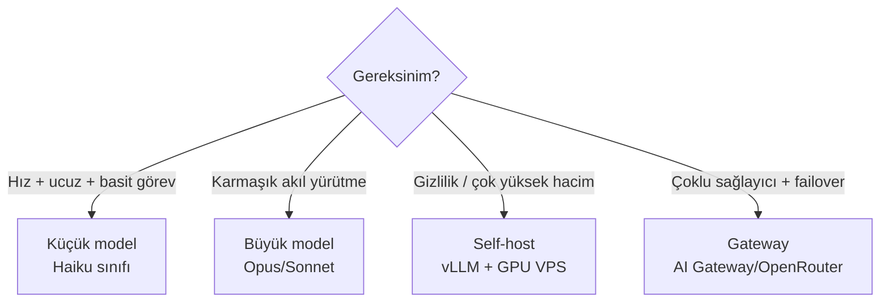

# 🧰 AI Uygulaması Yaparken Teknoloji Seçimi — Handbook

> [[00 HOME|🏠 Ana sayfaya dön]]
> Bir AI uygulamasının **her katmanı**: ne işe yarar, alternatifleri, hangisi ne zaman, ve **yaklaşık maliyetler**. Fiyatlar 2025–2026 civarı, USD, kabaca; kesin rakam için her zaman sağlayıcının sayfasına bak. Önerilerde senin stack'in (Next.js + Supabase) "varsayılan" olarak işaretli ✅.

---

## 1. Büyük Resim — Bir AI Uygulamasının Anatomisi



**Altın kural:** Her katmanda *bir* "managed/varsayılan" seçenekle başla. Sıkışmadan, ölçek/maliyet sorunu *kanıtlanmadan* daha karmaşık olana (self-host, VPS, Kubernetes) geçme. Erken optimizasyon = yavaş ilerleme.

---

## 2. İstek Hayat Döngüsü (request lifecycle)



---

## 3. 🎨 Frontend — Kullanıcının gördüğü katman

Kullanıcı arayüzü. AI uygulamalarında genelde **stream** (token token yazma) ve hızlı etkileşim önemli.

| Seçenek | Tür | En iyi olduğu yer | Dikkat |
|---|---|---|---|
| **Next.js** ✅ | React meta-framework (SSR+SSG+RSC) | SaaS, AI chat, SEO gereken her şey. AI SDK ile birinci sınıf | Öğrenme eğrisi orta; "App Router" kavramları |
| **React (Vite SPA)** | Kütüphane (sadece client) | Dashboard, iç araç, SEO gerekmeyen app | SEO/sosyal önizleme zayıf |
| **SvelteKit** | Meta-framework | Daha az kod, hızlı; küçük-orta app | Ekosistem React'ten küçük |
| **Nuxt (Vue)** | Meta-framework | Vue bilen ekip | — |
| **Astro** | İçerik odaklı | Blog, landing, döküman; "islands" | Ağır interaktif app için değil |
| **Düz HTML/JS** | — | Tek-dosya mini araç (bkz. [[Blueprints MOC]]) | Büyürse sürdürülemez |

**Stil / UI kit:** Tailwind CSS (utility) + **shadcn/ui** ✅ (kopyala-sahiplen bileşenler) en yaygın modern combo. Alternatif: MUI, Chakra, Mantine (hazır ama tema esnekliği daha az).

**AI'a özel:** Vercel **AI SDK** — `useChat`/`streamText` ile stream, tool calling, sağlayıcı değişimi tek satır. AI chat yapıyorsan neredeyse şart.

**Frontend nerede barınır?** Statik + serverless → Vercel ✅ / Netlify / Cloudflare Pages. (Bkz. §8 Hosting.)

---

## 4. 🔌 Backend / API — İş mantığı katmanı

Frontend ile veritabanı/LLM arasındaki köprü. API anahtarları **burada** durur (asla frontend'de değil).



| Seçenek | En iyi | Artı | Eksi |
|---|---|---|---|
| **Next.js API Routes / Server Actions** ✅ | Frontend ile aynı repo | Tek dağıtım, basit | Ağır CPU işi için değil |
| **Serverless Functions** (Vercel, AWS Lambda) | Değişken trafik | Sıfıra iner, otomatik ölçek | **Cold start**, zaman limiti, uzun job zor |
| **Edge Functions** (Cloudflare Workers, Vercel Edge) | Global düşük gecikme, auth/middleware | Çok hızlı, ucuz | Sınırlı runtime (tam Node yok), CPU limiti |
| **BaaS** (Supabase ✅ / Firebase) | MVP, küçük ekip | DB+Auth+Storage+API hazır | Çok özel mantıkta sınır |
| **Uzun-yaşayan server** (Node/Express, **Python FastAPI**) | Websocket, uzun AI job, ağır işlem | Tam kontrol, limit yok | Sen yönetirsin, hep açık (maliyet) |

> **AI özel not:** LLM çağrıları uzun sürebilir (10–60sn stream). Serverless'te zaman limitine dikkat (Vercel'de stream ile OK; "Fluid Compute" uzun işleri ucuzlatır). Çok uzun/ağır işler → **queue + worker** (§9) ya da uzun-yaşayan server.

---

## 5. 🗄️ Database — Ana veri katmanı



### 5a. Ana veritabanı
| Seçenek | Tür | En iyi | Maliyet (kabaca) |
|---|---|---|---|
| **Supabase** ✅ | Postgres + Auth + Storage + Realtime | MVP→SaaS; her şey bir arada | Free; Pro **$25/ay**+ |
| **Neon** | Serverless Postgres (branch'leme) | Önizleme ortamı, sıfıra inen DB | Free; ~$19/ay+ kullanım |
| **PlanetScale** | Serverless MySQL | Yüksek ölçek MySQL | Free yok artık; ~$39/ay+ |
| **MongoDB Atlas** | NoSQL doküman | Şeması değişken veri | Free; ~$9/ay+ |
| **Firebase Firestore** | NoSQL realtime | Mobil, realtime, hızlı başlangıç | Free; kullanım bazlı (okuma sayısı pahalanır) |
| **AWS RDS / Cloud SQL** | Managed Postgres/MySQL | Kurumsal, AWS/GCP içi | ~$15–100+/ay |

**ORM (kodla DB konuşma):** Prisma (yaygın, tip-güvenli) ✅ / Drizzle (hafif, SQL'e yakın) / doğrudan SQL.

### 5b. Vector DB — RAG'ın kalbi 🧠
AI uygulamasında metni "embedding" (sayı vektörü) yapıp **anlam benzerliğiyle** ararsın. (Bkz. §13 Sözlük: RAG, embedding.)

| Seçenek | Notu | Maliyet |
|---|---|---|
| **pgvector (Postgres eklentisi)** ✅ | Ayrı servis yok — Supabase/Neon içinde. Orta ölçeğe kadar ideal | DB'nin içinde, ek maliyet ~0 |
| **Pinecone** | Saf vector DB, yönetimsiz ölçek | Free; ~$50/ay+ ciddi kullanımda |
| **Qdrant** | Açık kaynak, self-host edilebilir | Cloud free; ya da kendi VPS'inde bedava |
| **Weaviate / Milvus** | Büyük ölçek, hibrit arama | Cloud / self-host |

> **Kural:** Önce **pgvector** ile başla (zaten Postgres'in var). Milyonlarca vektör + ağır filtreleme olunca özel vector DB'ye geç.

### 5c. Key-Value / Cache
| Seçenek | Ne için | Maliyet |
|---|---|---|
| **Upstash Redis** ✅ | Rate limit, cache, session, kuyruk (serverless'e uygun) | Free; istek başı kullanım |
| **Redis (self-host)** | Yüksek hacim, kendi sunucun | VPS maliyeti |

---

## 6. 🔐 Auth — Kimlik & oturum

"Kullanıcı kim?" ve "ne yapmaya yetkili?" Güvenliğin temeli; **kendin yazma**, hazır kullan.



| Seçenek | En iyi | Artı | Maliyet |
|---|---|---|---|
| **Supabase Auth** ✅ | Supabase kullanıyorsan | DB ile entegre, RLS, bedava | DB planına dahil |
| **Clerk** | Hızlı, güzel hazır UI | Bileşenler, org/team, çok az kod | Free 10k MAU; sonra ~$25/ay+ |
| **Auth0 / Okta** | Kurumsal, SSO/SAML | Olgun, uyumluluk | Pahalanır hızla |
| **NextAuth (Auth.js)** | Next.js, kendi DB'n | Bedava, esnek | UI ve akışı sen kurarsın |
| **Firebase Auth** | Mobil + Google ekosistem | Kolay, ücretsiz cömert | Google'a bağımlı |

**Bilmen gereken kavramlar:** `JWT` (taşınabilir token), `session` (sunucu tarafı oturum), `OAuth/OIDC` (Google ile giriş), `RBAC` (rol bazlı yetki), `RLS` (Postgres satır seviyesi güvenlik — Supabase'in süper gücü), `MFA/2FA`, `passkey`.

> **AI uygulaması notu:** Kullanıcı bazlı **kota/rate limit** ve **maliyet kontrolü** auth'a bağlıdır — "bu kullanıcı bu ay kaç token harcadı?" Token'ı auth katmanında kimliğe bağla.

---

## 7. 📦 Object Storage — Dosya / görsel / ses

PDF, kullanıcı yüklemeleri, üretilen görseller, ses dosyaları. DB'ye dosya koyma; storage'a koy, DB'ye **link** koy.

| Seçenek | Notu | Maliyet |
|---|---|---|
| **Cloudflare R2** ✅ | S3 uyumlu, **çıkış (egress) ücretsiz** — büyük fark | ~$0.015/GB ay, egress $0 |
| **AWS S3** | Standart, her yerde | Depolama ucuz ama **egress pahalı** |
| **Supabase Storage** | Supabase içinde, kolay | Plan'a dahil + kullanım |
| **Vercel Blob** | Vercel ile entegre | Kullanım bazlı |

> **Tuzak:** Maliyet sürprizi genelde **egress** (dışarı veri çıkışı). Çok indirilen dosya varsa R2 veya CDN şart.

---

## 8. 🖥️ Hosting / Compute Spektrumu — "Kodum nerede çalışır?"

En çok karıştırılan konu. Soldan sağa: **daha çok managed/kolay → daha çok kontrol/sorumluluk.**

```
 Statik     Serverless    Edge       PaaS/Container    VPS         Bare Metal
 hosting    Functions     Functions  (Render/Railway)  (Hetzner)   (kendi donanım)
 ──────────────────────────────────────────────────────────────────────────────►
 ◄ Sen hiç sunucu yönetmezsin            |            Sen sunucu yönetirsin ►
 ◄ Otomatik ölçek, sıfıra iner           |            Hep açık, sabit kapasite ►
 ◄ Saniyelik faturalandırma              |            Aylık sabit ücret ►
```

| Katman | Ne | En iyi | Maliyet |
|---|---|---|---|
| **Statik hosting** | HTML/JS/CDN | Landing, blog, SPA | Çoğu free |
| **Serverless** (Vercel ✅, Netlify, Lambda) | İstek başı çalışan fonksiyon | Değişken trafik, MVP, çoğu web app | Free tier; sonra kullanım/$20/ay+ |
| **Edge** (Cloudflare Workers) | Kullanıcıya yakın, global | Auth, redirect, hafif API | Çok ucuz, free cömert |
| **PaaS / Container** (Render, Railway, Fly.io) | Docker'ı sen verirsin, onlar çalıştırır | Uzun-yaşayan server, worker, Python AI | ~$5–25/ay+ |
| **VPS** (Hetzner, DigitalOcean, Linode) | Çıplak Linux sunucu, sen kurarsın | Tam kontrol, sabit ucuz güç, self-host (Ollama, DB, Qdrant) | **Hetzner ~€4–50/ay** (en ucuz/güçlü), DO/Linode ~$6/ay+ |
| **Kubernetes** (EKS/GKE) | Konteyner orkestrasyon | Çok servis, büyük ekip, yüksek ölçek | Yüksek + ops yükü |

### VPS ne zaman gerekir? 🧭

**VPS sağlayıcı kıyas:** Hetzner = en ucuz/güçlü (Avrupa) · DigitalOcean = en dostça arayüz/döküman · Linode/Vultr = arası · AWS EC2/Lightsail = AWS ekosistemi içindeysen.

---

## 9. ⏱️ Arka Plan İşleri, Queue, Cron

LLM çağrısı uzun sürerse, toplu işlem, zamanlanmış görev → isteği bekletme, **kuyruğa** at.

| Seçenek | Ne için | Maliyet |
|---|---|---|
| **Inngest** ✅ | Event-driven job, retry, step (AI workflow'a ideal) | Free cömert; kullanım |
| **Trigger.dev** | Uzun job, AI pipeline | Free; kullanım |
| **Upstash QStash** | Basit HTTP kuyruk + cron, serverless dostu | Çok ucuz |
| **Vercel Cron** | Zamanlanmış fonksiyon | Plan'a dahil |
| **BullMQ + Redis** | Kendi worker'ın (VPS'te) | Altyapı maliyeti |

> **AI özel:** "Belge yükle → 200 sayfayı embed et → vector DB'ye yaz" gibi işler asla istek içinde yapılmaz. Job'a at, kullanıcıya "işleniyor" göster.

---

## 10. 🤖 LLM / AI Katmanı — Modelin kendisi

| Yaklaşım | Seçenek | En iyi | Maliyet mantığı |
|---|---|---|---|
| **Hosted API** ✅ | **Anthropic Claude**, OpenAI, Google Gemini | Üretim app'lerin %95'i | **Token başı** (girdi+çıktı). Sıfır altyapı |
| **Inference host** | Groq (çok hızlı), Together, Fireworks, Replicate | Açık model + ucuz/hızlı | Token / saniye başı |
| **Self-host** | Ollama (local), vLLM (VPS/GPU) | Gizlilik, çok yüksek hacim, offline | GPU pahalı; ancak çok hacimde mantıklı |
| **Gateway** | Vercel AI Gateway, OpenRouter | Sağlayıcılar arası yük devri, tek fatura, maliyet takibi | İnce komisyon / aynı token fiyatı |

**Token maliyeti sezgisi (kabaca, 2025–2026):**
- Küçük/hızlı modeller (Haiku, GPT-mini sınıfı): ~**$0.25–1 / milyon girdi token**
- Büyük/akıllı modeller (Opus, GPT büyük): ~**$3–15 / milyon girdi token**, çıktı 3–5× daha pahalı
- **1 token ≈ 0.75 kelime.** Bir sohbet turu ~500–2000 token.

**Maliyeti düşüren 4 kaldıraç:** ① **Prompt caching** (tekrarlı bağlamı cache'le — büyük tasarruf) ② doğru model seçimi (her şeye en büyük model atma) ③ kısa prompt + RAG ile sadece gerekli bağlam ④ çıktıyı sınırla (`max_tokens`).



---

## 11. 📡 Observability & Güvenlik (atlanan ama kritik)

| İhtiyaç | Araç | Not |
|---|---|---|
| Hata takibi | **Sentry** | Frontend+backend exception |
| Log / metrik | Vercel/CF dahili, Axiom, Grafana | — |
| **LLM trace** | **Langfuse** ✅, LangSmith, Helicone | Prompt/cevap/token/maliyet izleme — AI app'te şart |
| Rate limit | Upstash Ratelimit | Kötüye kullanım + maliyet koruması |
| Secret yönetimi | Env vars, Doppler, Vault | API key'i **asla** repo'ya/koda gömme |
| Ödeme (gerekirse) | Stripe ✅ / iyzico (TR) | Abonelik, kullanım bazlı faturalama |

---

## 12. 🍱 Üç Hazır Reçete (referans mimariler)

### A) Hafta Sonu MVP (hız önceli, ~$0–25/ay)
```
Next.js (Vercel) + Supabase (DB+Auth+Storage+pgvector)
 + Anthropic API + Vercel AI SDK
```
Tek repo, sıfır sunucu yönetimi. [[Blueprints MOC]] + [[Yetenekler MOC]] çoğunu kapsar.

### B) Ciddi SaaS (ölçeklenebilir, ~$50–300/ay)
```
Next.js (Vercel) · Neon/Supabase Postgres · Clerk (auth)
 · Inngest (job) · Upstash (cache/ratelimit) · R2 (storage)
 · Langfuse (gözlem) · Stripe (ödeme) · LLM API
```

### C) Maliyet-Hassas / Yüksek Hacim (kontrol önceli)
```
Frontend → Vercel/CF Pages
Backend  → Hetzner VPS (Docker): FastAPI + Postgres + Qdrant + Redis
Model    → çok hacimde self-host (vLLM, GPU); azsa hosted API
```
Daha ucuz çalışır ama **DevOps emeği** ister.

---

## 13. 📖 Terimler Sözlüğü (hızlı referans)

| Terim | Bir cümleyle |
|---|---|
| **Frontend / Backend** | Kullanıcının gördüğü arayüz / sunucuda çalışan iş mantığı |
| **SSR / SSG / CSR** | Sayfayı sunucuda / build'de / tarayıcıda üretmek |
| **Serverless** | Sunucu yönetmeden, istek başı çalışan kod; boştayken sıfır maliyet |
| **Edge** | Kullanıcıya coğrafi yakın, çok düşük gecikmeli çalışma |
| **Cold start** | Serverless fonksiyonun uykudan ilk uyanma gecikmesi |
| **PaaS / BaaS** | Platform-as-a-Service (kodu çalıştırır) / Backend-as-a-Service (DB+Auth+API hazır) |
| **VPS** | Kiralık çıplak sanal Linux sunucu; her şeyi sen kurarsın |
| **CDN** | Statik dosyaları dünyaya dağıtan önbellek ağı |
| **ORM** | Kodla DB konuşmayı kolaylaştıran katman (Prisma, Drizzle) |
| **JWT** | İçinde kimlik taşıyan, imzalı taşınabilir token |
| **OAuth / OIDC** | "Google/GitHub ile giriş" protokolü |
| **RLS** | Postgres'te satır bazlı erişim kuralı (kullanıcı sadece kendi verisini görür) |
| **RAG** | Sorudan önce ilgili belgeleri arayıp modele bağlam olarak vermek |
| **Embedding** | Metni anlamını temsil eden sayı vektörüne çevirme |
| **Vector DB** | Embedding'leri benzerliğe göre arayan veritabanı |
| **Token** | Modelin işlediği metin parçası (~0.75 kelime); faturalama birimi |
| **Prompt caching** | Tekrar eden prompt bağlamını önbelleğe alıp maliyet/gecikme düşürme |
| **Egress** | Veriyi dışarı çıkarma ücreti — bulut faturasının gizli kalemi |
| **Rate limit** | Birim zamanda izin verilen istek sayısı (kötüye kullanım/maliyet koruması) |
| **Queue / Worker** | İşi kuyruğa atıp arka planda işleyen sistem |
| **Container / Docker** | Uygulamayı bağımlılıklarıyla paketleyip her yerde aynı çalıştırma |

---

## 14. ✅ Karar Özeti — "Ne seçeyim?" tek bakış

| Katman | Önce dene (varsayılan) | Büyüyünce / özel durum |
|---|---|---|
| Frontend | **Next.js + Tailwind + shadcn/ui** | Astro (içerik), SvelteKit (hafif) |
| AI arayüz | **Vercel AI SDK** | LangChain (karmaşık zincir) |
| Backend | **Next API / Server Actions** | FastAPI + VPS (ağır/uzun iş) |
| DB | **Supabase (Postgres)** | Neon (branch), Mongo (doküman) |
| Vector | **pgvector** | Pinecone/Qdrant (büyük ölçek) |
| Auth | **Supabase Auth** / Clerk | Auth0 (kurumsal SSO) |
| Storage | **R2** / Supabase Storage | S3 (AWS içindeysen) |
| Hosting | **Vercel** | Railway/Render → VPS (Hetzner) |
| Jobs | **Inngest** | BullMQ+Redis (kendi worker) |
| LLM | **Anthropic API + AI Gateway** | self-host vLLM (hacim/gizlilik) |
| Gözlem | **Sentry + Langfuse** | Grafana stack |

> İlgili kütüphane: bir katmanı kurarken [[Yetenekler MOC]]'ta hazır skill/command olabilir; sıfırdan app için [[Blueprints MOC]]. Kullanım: [[Claude için kullanım]].
