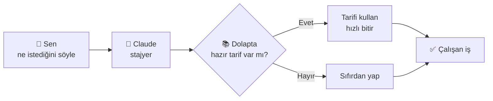
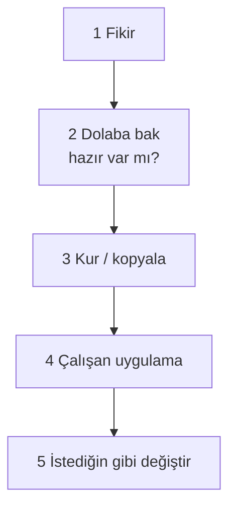

# 🌱 Sıfırdan Başlangıç — Bu Sistem Nedir? (Herkes İçin)

> [[00 HOME|🏠 Ana sayfaya dön]]
> Hiç teknik bilgin yoksa **buradan başla**. Hiçbir şeyi ezberlemene gerek yok; sadece oku, mantığını anla. Kod yok, terim yağmuru yok — bol benzetme var. ☕

---

## 🧠 En kısa hâliyle: bu ne?

Düşün ki çok yetenekli ama senin işlerini bilmeyen bir **stajyer** işe aldın. Akıllı, hızlı, yorulmuyor — ama "biz işleri nasıl yaparız"ı bilmiyor.

- **Claude** = o stajyer. (Yazılım yazabilen bir yapay zekâ.)
- **Bu kütüphane** = stajyere verdiğin **el kitapları, hazır tarifler ve şablonlar** dolabı.
- **Sen** = ne istediğini söyleyen patron.

Sen "şunu yap" diyorsun, stajyer (Claude) önce **dolaba bakıyor** ("bu işin hazır tarifi var mı?"), varsa onu kullanıyor, yoksa sıfırdan yapıyor. İşte tüm sistem bu.

---

## 🧩 Dolapta 3 çeşit şey var

Hepsi "işi nasıl yapacağını anlatan" dosyalar. Farkları şöyle:

| | Günlük benzetme | Ne işe yarar |
|---|---|---|
| **🧱 Blueprint** | **IKEA mobilya kutusu** | İçinden komple, çalışan bir mini-uygulama çıkar. Kur, kullan. (Örn: QR menü, fatura kesici.) "Bana hazır bir şey lazım" dersen buraya bakılır. |
| **⚙️ Skill** | **Aşçının kafasındaki bilgi** | Claude'a bir konuda *uzmanlık* verir. Arka planda durur, iş o konuya gelince Claude kendi çıkarır kullanır. (Örn: "admin paneli nasıl yapılır" bilgisi.) |
| **▶️ Command** | **Tek tuşla yemek tarifi** | Sen `/komut` yazınca tam o işi adım adım yapar. Açıkça sen tetiklersin, sürpriz yok. |

> Aynı 145 iş hem **skill** hem **command** olarak var. Skill = "Claude bilsin, gerekince kullansın." Command = "Tam şimdi şunu yap." İkisi aynı işin sessiz ve sesli hâli.

---

## 🗂️ Peki bu dolap nerede? — "İkinci beyin"

Bütün bu el kitapları **Obsidian** denen bir not uygulamasında duruyor (senin "ikinci beynin"). Bilgisayarda bir klasör; içinde düzenli notlar var. Gezmek için tek kapı: **[[00 HOME]]**. Oradan her şeye link var — tıkla, gez.

Neden burada? Çünkü dağınık dosyalar yerine **tek, düzenli bir hafıza**. Hem sen bakıyorsun, hem Claude buradan besleniyor.

---

## 🚶 Bir iş baştan sona nasıl yürür? (örnek)

Diyelim **"kafem için QR menü"** istiyorsun. Adımlar:

1. **Fikir** → "QR menü lazım."
2. **Dolaba bak** → [[Blueprints MOC]]'ta `qr-menu` var. ✅ Şanslıyız, hazır.
3. **Claude kurar** → ilgili dosyaları yeni bir klasöre kopyalar, sen `claude` açıp `/kur` yazarsın.
4. **3–5 dakika** sonra çalışan bir sayfa (`index.html`) hazır — tarayıcıda açılır.
5. **İstersen değiştir** → "rengi yeşil yap", "logoyu ekle" dersin, Claude düzeltir.

Eğer dolapta olmasaydı (4. madde yerine): Claude "hazırı yok, sıfırdan yapıyorum" der ve yine yapar — sadece biraz daha uzun sürer.

---

## 📖 5 kelimelik mini sözlük (sadece bunlar yeter)

| Kelime | Günlük karşılığı |
|---|---|
| **Uygulama (app)** | Telefondaki/bilgisayardaki çalışan program. |
| **Frontend** | Uygulamanın **gördüğün** yüzü (ekran, butonlar). |
| **Backend** | Arka mutfak — kullanıcının görmediği, işi yapan kısım. |
| **Veritabanı (database)** | Bilgilerin saklandığı düzenli **dolap/defter**. |
| **Yapay zekâ / model (LLM)** | Yazı yazıp soru cevaplayan **akıllı beyin** (Claude gibi). |

Daha derin teknik isim ve maliyet bilgisi isteyince → [[AI Uygulaması — Teknoloji Seçimi Handbook]]. Ama oraya **şimdi gitmene gerek yok**; bu sayfa başlangıç için yeterli.

---

## ✅ Aklında kalsın
- Claude = yetenekli stajyer, **sen yönlendirirsin**.
- Her işten önce **önce dolaba bakılır** (hazır var mı?).
- 3 çeşit hazır: **Blueprint** (komple ürün), **Skill** (sessiz uzmanlık), **Command** (tek-tuş iş).
- Kapı: **[[00 HOME]]**. Kaybolursan oraya dön.
